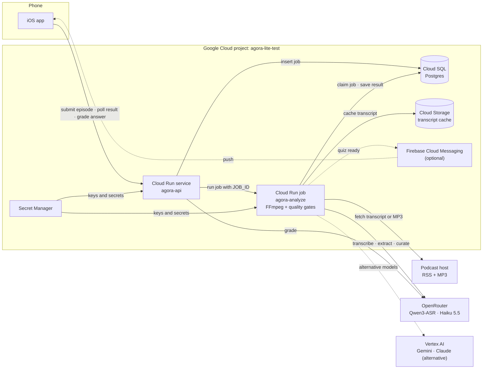
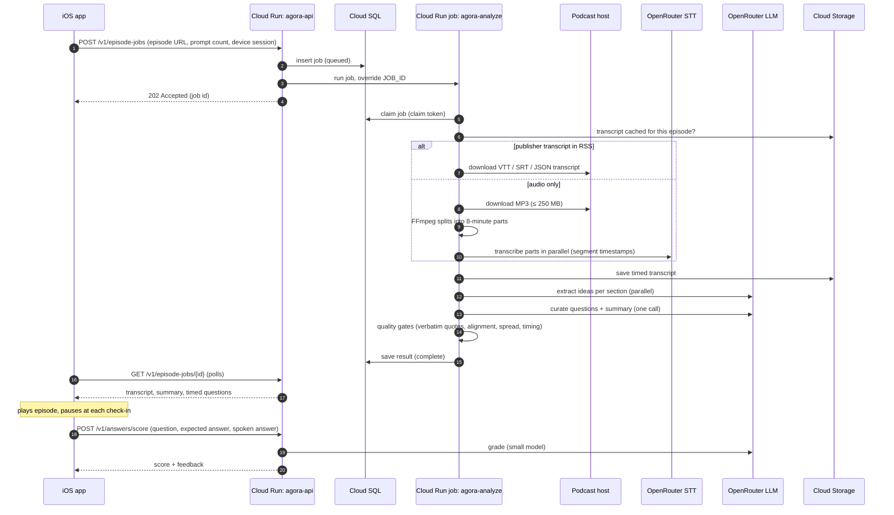

# Agora Lite on Google Cloud: small-scale testing plan

**Date:** October 25, 2026
**Scope:** How to stand up a small version of The Agora LA that reproduces the app's AI functionality (transcribe an episode, write evidence-backed quiz questions, time them to the audio, grade answers) on Google Cloud, with OpenRouter as an optional model provider.
**Decision context:** The MCP / "bring your own Claude or ChatGPT plan" strategy was dropped on October 25, 2026. This plan replaces it. The broader scale review that preceded it is in [`agora-scale-review-2026-10-25.html`](agora-scale-review-2026-10-25.html).

---

## 1. Recommendation

Build **Agora Lite**: keep the existing iOS app, move the backend to **Cloud Run**, run each episode as a **Cloud Run job**, keep **Postgres on Cloud SQL** so the existing backend code is reused, and call models through **OpenRouter** with small, current models.

| Question | Recommended answer for small-scale testing | Why |
|---|---|---|
| Where does the backend run? | Cloud Run service (`agora-api`) plus a Cloud Run job (`agora-analyze`) | Scales to zero, pay per second, no servers to manage. Jobs run up to 7 days per task (1 hour with a GPU). |
| Database | Cloud SQL for PostgreSQL, `db-f1-micro` | The backend already uses Postgres (job queue, results). About $7.67/month. |
| Transcription | OpenRouter speech-to-text: Qwen3-ASR-1.7B, with Whisper large-v3 as a fallback | Best open model, $0.027 per audio hour, no GPU to run. Confirm OpenRouter returns its timestamps first (section 6). |
| Question writing | Claude Haiku 5.5 or gpt-6-luna ($0.10 / $0.50 per million tokens), through OpenRouter or Vertex AI | About 2–3¢ per hour-long episode, against roughly $0.40–0.80 today. |
| Who pays for AI | A project-owned OpenRouter key with a hard credit limit, kept in Secret Manager | Testers need no setup. **Needs owner sign-off:** the repo's rules forbid an Agora-owned AI key. The rule-compliant alternative is the app's existing listener sign-in (section 4). |
| Client | The existing iOS app on TestFlight | Already built and in testers' hands; only `AGORA_API_BASE_URL` changes. |

**Expected cost:** about **$20–30 per month** for 20 testers analyzing 10 one-hour episodes each (section 7).
**Expected effort:** about **3–5 days** for one developer who knows the codebase (section 8).

---

## 2. Architecture



The phone never holds a project key. Every AI call happens server-side, inside Google Cloud, using a key read from Secret Manager (or a Vertex AI service account in the all-Google variant).

---

## 3. Service to service, step by step



What each service does:

| Step | Service | What happens | Existing code reused |
|---|---|---|---|
| 1–4 | Cloud Run `agora-api` | Validates the request, dedupes, stores the job, starts one job execution | `Backend/src/app.ts` |
| 5 | Cloud SQL | Claim tokens stop two executions processing the same job | `Backend/src/worker.ts` (claim logic) |
| 6–10 | Cloud Run `agora-analyze` | Publisher transcript first; otherwise download, split, transcribe, re-offset timestamps | `Backend/src/transcription.ts`, `analysisService.ts` |
| 11–13 | Cloud Run `agora-analyze` | Map (extract per section) then reduce (curate), then deterministic gates | `Backend/src/promptPipeline.ts`, `transcriptTiming.ts` |
| 14–16 | `agora-api` → app | App polls until complete (FCM push optional) | `Sources/CloudAnalysisClient.swift` |
| 17–19 | `agora-api` | Grades answers with the gracious rubric | `Backend/src/gradingPolicy.ts` |

---

## 4. Trade-offs

### 4.1 Who pays for AI

| Option | Tester setup | Cost to project | Spending control | Repo rules |
|---|---|---|---|---|
| **A. Listener's OpenRouter key** (built today) | Create OpenRouter account, add ~$5, one-tap sign-in | $0 AI | Listener's own balance | Compliant |
| **B. Project OpenRouter key, server-side** | None | ~3–6¢ per episode | Hard per-key credit limit on OpenRouter | Needs owner sign-off |
| **C. Project Vertex AI (service account)** | None | Same models, Google bill | Budget alerts only; they notify, they don't stop spend | Needs owner sign-off |

For a test whose goal is learning whether the experience works, B gives the cleanest signal because testers skip the account step. A costs the project nothing and needs no rule change. C removes the third-party key entirely but has no hard spending stop, so the API must enforce its own per-device quota.

Whichever option is used, add **Firebase App Check (App Attest)** to the API before inviting testers, so only the real app can trigger paid work.

### 4.2 Transcription

| Option | Accuracy (Open ASR Leaderboard WER) | Timestamps | Cost per audio hour | Operations |
|---|---|---|---|---|
| **OpenRouter Qwen3-ASR-1.7B** (open, Apache-2.0) | 4.94 average; 5.84 on earnings calls | Through OpenRouter: **unverified**, test first | $0.027 | None |
| OpenRouter Whisper large-v3 (current) | 6.66 average | Segment, verified in this codebase | $0.027 | None |
| OpenRouter ElevenLabs Scribe v2 (API) | 4.55 average, best tested on long audio | Word + speaker labels | $0.22 | None |
| **Self-hosted on Cloud Run GPU**: Qwen3-ASR + ForcedAligner + pyannote | Same model; full-length accuracy unpublished | Word (aligner, ≤5-minute windows) + speaker labels | ~1–5¢ including cold start (estimate) | Build a GPU container; L4 quota is 3 GPUs per region to start |
| Google Speech-to-Text V2, Chirp 3 | Not on the leaderboard | Word timestamps listed as **unsupported**; enabling them degrades accuracy and caps batch files at 20 minutes | $0.18 (dynamic batch, standard models) | None |
| Gemini audio prompt (Vertex AI) | Not benchmarked here | Written by the model, approximate | ~5–10¢ (estimate) | None |

**Conclusion:** at test scale, a hosted open model through OpenRouter is cheaper than a GPU you start for each episode, and needs no operations. Google's own speech service is not a good fit for check-ins because it doesn't support reliable word timestamps. A self-hosted GPU service becomes worthwhile for steady volume, speaker labels, or privacy.

Cloud Run GPU facts used above: NVIDIA L4 (24 GB) at $0.0001867 per second without zonal redundancy ($0.67/hour), plus at least 4 vCPU and 16 GiB at $0.000018 per vCPU-second and $0.000002 per GiB-second, so about $1.05/hour for the minimum shape. Instances scale to zero and start in about 5 seconds before the model loads. GPU jobs are limited to 1-hour tasks.

### 4.3 Question writing

| Model (provider) | Input / output per 1M tokens | Est. per 60-min episode | Notes |
|---|---|---|---|
| Claude Haiku 5.5 (OpenRouter or Vertex AI) | $0.10 / $0.50 (Vertex: up to 100K input tokens) | ~$0.02–0.03 | Candidate default |
| gpt-6-luna (OpenRouter) | $0.10 / $0.50 | ~$0.02–0.03 | Candidate default |
| Gemini 3.5 Flash-Lite (Vertex AI) | $0.30 / $2.50 | ~$0.08–0.15 | Google-native |
| Gemini 3.8 Flash (Vertex AI) | $0.75 / $3.75 until Dec 31, 2026; then $1.50 / $7.50 | ~$0.13–0.25 | Introductory price ends |
| gpt-5.6-terra (current default) | $2.00 / $12.00 | ~$0.40–0.80 | Quality baseline |
| gpt-6-astra (current Maximum tier) | $10.00 / $50.00 | ~$0.80–1.90 | Quality ceiling |

Episode estimates assume about 9,000 words, roughly 20,000 tokens with timestamp markers, eight extraction calls and one curation call. Reasoning tokens are not logged yet, so output ranges are wide. Run `Backend/scripts/compare-curation-models.mjs` against the real quality gates before switching the default.

### 4.4 Orchestration

| Option | Fit | Notes |
|---|---|---|
| **Cloud Run job per episode** | Recommended | Billed only while running; tasks up to 7 days; retries built in. |
| Cloud Tasks → HTTP endpoint on the service | Good for rate limiting | HTTP task dispatch deadlines are short (minutes), so long episodes risk duplicate runs; the claim token prevents double processing. |
| Workflows | Overkill for now | Useful when steps branch (upload, YouTube, retries per stage). |
| Keep the in-process worker | Simplest migration | Needs an always-on instance (instance-based billing, min instances = 1): about $50/month for 1 vCPU and 2 GiB. |

### 4.5 Database

| Option | Code change | Cost | Notes |
|---|---|---|---|
| **Cloud SQL Postgres** (`db-f1-micro`) | None | $0.0105/hour (~$7.67/month) plus storage | Shared core has no SLA; fine for testing. `db-g1-small` is $0.035/hour. |
| Firestore | Rewrite queue and storage layer | Free tier covers testing | Better long-term serverless fit; not worth a rewrite for a test. |

### 4.6 Client

| Option | Notes |
|---|---|
| **Existing iOS app (TestFlight)** | Recommended. Already has playback, check-ins, spoken answers, retry. Point `AGORA_API_BASE_URL` at the Cloud Run URL. |
| Small web client on Cloud Run | Fastest to share (a link, no TestFlight). Loses hands-free audio and the iPhone's speech features. Useful later as an internal quality-review page. |

---

## 5. Possibilities after the first test

| Capability | How on GCP | Caveat |
|---|---|---|
| Shared transcript cache | Key transcripts in Cloud Storage by feed GUID and audio URL; every listener reuses them | Privacy policy currently promises deletion within 7 days |
| Push when a quiz is ready | Firebase Cloud Messaging from the job | Needs APNs key setup |
| Uploaded audio and video | Signed upload URL to Cloud Storage; Eventarc triggers the job | Storage and retention policy |
| YouTube | Gemini on Vertex AI accepts public YouTube URLs (pre-GA) | Approximate timestamps; YouTube terms review; downloading audio is not allowed |
| Speaker-aware questions | Self-hosted Qwen3-ASR + pyannote on Cloud Run GPU | GPU quota and container work |
| On-device grading | Apple Foundation Models on iOS 26+ | Older phones keep server or heuristic grading |

---

## 6. Risks and unknowns

1. **Qwen3-ASR timestamps through OpenRouter are unverified.** Run a two-model comparison on one real episode before switching (about 3¢ of usage).
2. **Phone fallback bug.** The on-phone pipeline caps responses at 10,000 tokens while asking gpt-5.6-terra for high reasoning (`Sources/OpenRouterClient.swift:316–317`). The October 25 test import produced a full transcript but zero questions with "The AI returned an unreadable response." Fix or disable the phone fallback for the test.
3. **Non-Whisper models are blocked in code.** `Backend/src/openAIClient.ts:16` replaces any model whose name lacks "whisper" with Whisper large-v3.
4. **Google budgets don't stop spending.** Use the OpenRouter per-key limit (option B) or a per-device quota in the API (option C).
5. **The repo forbids an Agora-owned AI key.** Options B and C need the owner's agreement, or use option A.
6. **The Railway production backend returned 404 on October 25.** Moving to Cloud Run replaces it; until then the app analyzes on the phone.

---

## 7. Monthly cost at small scale

Assumptions: 20 testers × 10 one-hour episodes = 200 episodes a month, no publisher transcripts, 8 graded answers per episode, us-central1.

| Item | Basis | Monthly |
|---|---|---|
| Cloud Run `agora-api` | Request-based billing, scales to zero; free tier 180,000 vCPU-seconds, 360,000 GiB-seconds, 2M requests | ~$0 |
| Cloud Run `agora-analyze` | ~7 minutes × 2 vCPU per episode ≈ 170,000 vCPU-seconds | ~$0–5 |
| Cloud SQL `db-f1-micro` + 10 GB SSD | $0.0105/hour + storage | ~$9–10 |
| Cloud Storage, Secret Manager, Artifact Registry | Small objects, a few secrets, one image | ~$1 |
| Transcription (Qwen3-ASR via OpenRouter) | 200 hours × $0.027 | ~$5.40 |
| Question writing (Haiku 5.5) | 200 × ~$0.03 | ~$6 |
| Grading (Haiku 5.5) | 1,600 answers × ~$0.0005 | ~$1 |
| **Total** | | **~$20–30** |

With today's default model (gpt-5.6-terra) instead of Haiku 5.5, question writing alone would be about $80–160 a month at the same volume.

---

## 8. Build plan

| # | Change | Where | Estimate |
|---|---|---|---|
| 1 | Split the entrypoint: `api` (no worker loop) and `analyze-job` (process one `JOB_ID`, then exit) | `Backend/src/server.ts`, new `Backend/src/analyzeJob.ts` | 0.5 day |
| 2 | After inserting a job, start one Cloud Run job execution with `JOB_ID` as an override | `Backend/src/app.ts` | 0.5 day |
| 3 | Model settings: extraction follows the tier, default to Haiku 5.5 or gpt-6-luna, allow non-Whisper speech models | `Backend/src/config.ts`, `openAIClient.ts` | 0.5 day |
| 4 | Project-key mode with per-device daily quota and App Check (options B or C only) | `Backend/src/app.ts` | 1 day |
| 5 | Fix or disable the phone fallback; point the app at the Cloud Run URL | `Sources/OpenRouterClient.swift`, project build settings | 0.5 day |
| 6 | Deploy and smoke-test with three real episodes | Google Cloud | 0.5–1 day |

### Deployment sketch (not yet run)

```bash
gcloud config set project agora-lite-test
gcloud services enable run.googleapis.com sqladmin.googleapis.com secretmanager.googleapis.com \
  artifactregistry.googleapis.com cloudbuild.googleapis.com storage.googleapis.com

# Database
gcloud sql instances create agora-db --database-version=POSTGRES_17 --tier=db-f1-micro --region=us-central1
gcloud sql databases create agora --instance=agora-db
gcloud sql users create agora --instance=agora-db --password="$(openssl rand -hex 16)"

# Secrets (generate locally; never commit)
openssl rand -hex 32 | gcloud secrets create AGORA_SESSION_SECRET --data-file=-
openssl rand -hex 32 | gcloud secrets create PROVIDER_CREDENTIAL_ENCRYPTION_KEY --data-file=-
# Option B only: a capped OpenRouter key created in the OpenRouter dashboard
# gcloud secrets create OPENROUTER_API_KEY --data-file=-

# API service (builds Backend/Dockerfile with Cloud Build)
gcloud run deploy agora-api --source Backend --region us-central1 \
  --add-cloudsql-instances agora-lite-test:us-central1:agora-db \
  --set-env-vars NODE_ENV=production,DATABASE_SSL_MODE=disable \
  --set-secrets AGORA_SESSION_SECRET=AGORA_SESSION_SECRET:latest,PROVIDER_CREDENTIAL_ENCRYPTION_KEY=PROVIDER_CREDENTIAL_ENCRYPTION_KEY:latest

# Analysis job (after build-plan step 1 adds the job entrypoint)
gcloud run jobs deploy agora-analyze --source Backend --region us-central1 \
  --command node --args dist/analyzeJob.js \
  --task-timeout 3600 --max-retries 1 --cpu 2 --memory 4Gi \
  --set-cloudsql-instances agora-lite-test:us-central1:agora-db
```

`DATABASE_URL` points at the Cloud SQL Unix socket (`host=/cloudsql/agora-lite-test:us-central1:agora-db`), which is why SSL mode is `disable`. The existing Dockerfile already runs migrations before the server starts.

---

## 9. Research data

### Prices checked on October 25, 2026

| Item | Price | Source |
|---|---|---|
| Cloud Run CPU, instance-based | $0.000018 per vCPU-second | cloud.google.com/run/pricing |
| Cloud Run memory, instance-based | $0.000002 per GiB-second | same |
| Cloud Run CPU, request-based (active) | $0.000024 per vCPU-second | same |
| Cloud Run free tier | Request-based: 180,000 vCPU-s, 360,000 GiB-s, 2M requests; instance-based: 240,000 vCPU-s, 450,000 GiB-s | same |
| Cloud Run NVIDIA L4 GPU | $0.0001867/s (no zonal redundancy); $0.0002909/s (zonal) | same |
| Cloud Run NVIDIA RTX PRO 6000 GPU | $0.00036522/s (no zonal redundancy) | same |
| Cloud Run GPU requirements | L4: ≥4 vCPU, ≥16 GiB; instance-based billing; scale to zero; ~5 s start; initial quota 3 GPUs per region | docs.cloud.google.com/run/docs/configuring/services/gpu |
| Cloud Run job task timeout | Default 10 min; max 168 hours; GPU tasks max 1 hour | docs.cloud.google.com/run/docs/configuring/task-timeout |
| Cloud SQL `db-f1-micro` / `db-g1-small` | $0.0105 / $0.035 per hour; no SLA on shared core | cloud.google.com/sql/pricing |
| Speech-to-Text V2 dynamic batch, standard models (incl. Chirp) | $0.003/min first tier | cloud.google.com/speech-to-text/pricing |
| Chirp 3 limits | Word timestamps listed unsupported; batch ≤20 min with word timestamps; diarization batch-only, 14 locales; regions `us`, `eu` | docs.cloud.google.com/speech-to-text/v2/docs/chirp_3-model |
| Vertex AI Gemini 3.5 Flash-Lite | $0.30 input (incl. audio) / $2.50 output per 1M | cloud.google.com/vertex-ai/generative-ai/pricing |
| Vertex AI Gemini 3.5 Flash | $1.50 / $9.00 per 1M | same |
| Vertex AI Gemini 3.6–3.8 Flash | $0.75 / $3.75 through Dec 31, 2026; $1.50 / $7.50 from Jan 1, 2027 | same |
| Vertex AI Claude Haiku 5.5 | $0.10 / $0.50 per 1M (≤100K input tokens); batch $0.05 / $0.25 | same |
| OpenRouter Claude Haiku 5.5 / gpt-6-luna | $0.10 / $0.50 per 1M | openrouter.ai/api/v1/models |
| OpenRouter gpt-5.6-terra / gpt-6-astra | $2 / $12 and $10 / $50 per 1M | same |
| OpenRouter speech-to-text | Qwen3-ASR $0.027/h; Whisper large-v3 $0.027/h; turbo $0.012/h; Scribe v2 $0.22/h | openrouter.ai/collections/speech-to-text-models (via research agent) |

Not verified directly (Google's free-tier page did not load): the $300 / 90-day new-customer credit, and Always Free limits for Cloud Storage, Firestore, and Secret Manager.

### Open-source transcription (Hugging Face Open ASR Leaderboard, updated Oct 22, 2026)

| Model | License | Public average WER | Earnings-call WER | Timestamps | Notes |
|---|---|---|---|---|---|
| Qwen3-ASR-1.7B + ForcedAligner-0.6B | Apache-2.0 | 4.94 | 5.84 | Word via aligner | vLLM support; aligner ≤5-minute windows |
| NVIDIA Parakeet TDT 0.6B v3 | CC-BY-4.0 | 5.58 | 5.85 | Word + segment | Very fast; long audio via local attention or chunking |
| MOSS-Transcribe-Diarize 0.9B | Apache-2.0 | n/a | 6.09 | Segment + speaker | One pass up to 90 minutes |
| Canary-1B-v2 | CC-BY-4.0 | n/a | 7.28 | Word + segment | Auto-chunking |
| Whisper large-v3 | MIT | 6.66 | 8.09 (turbo) | Segment; word via WhisperX | Current model in this app |

Avoid for commercial use: Canary-1B and Sortformer v1 (CC-BY-NC). Avoid for check-ins: Cohere Transcribe and Granite Speech 5.0 (no timestamps).

### How this was researched

Repository code was read directly at commit `572a4f6`. Google Cloud prices come from Google's public pricing and documentation pages on October 25, 2026. OpenRouter model prices come from its public models API the same day. Benchmark and licensing data were gathered by research agents from model cards, the Hugging Face leaderboard, and vendor documentation; claims they could not confirm are labeled as unverified or estimates.
